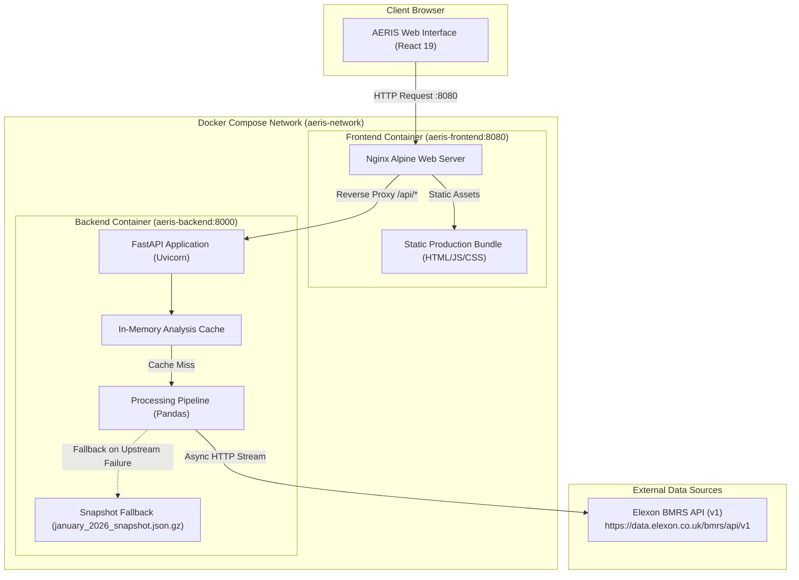

# AERIS — Wind Forecast Intelligence

> **UK Wind Generation & Day-Ahead Forecast Analytics for Great Britain (January 2026)**

[](https://fastapi.tiangolo.com)
[](https://react.dev)
[](https://www.docker.com)
[](https://www.python.org)
[](https://github.com/astral-sh/uv)
[]()

---

## 1. Executive Summary & Value Proposition

**AERIS — Wind Forecast Intelligence** is an analytics platform engineered to evaluate the precision, systemic bias, and operational reliability of Great Britain’s national wind power generation forecasts throughout January 2026. 

As wind generation supplies a rapidly expanding share of the UK transmission grid, accurate day-ahead forecast intelligence is critical for power traders, energy suppliers, and grid balancing desks. Forecast errors trigger costly system imbalance charges (*Cashout prices*) and force the National Energy System Operator (NESO) to dispatch expensive balancing reserves.

AERIS ingests official settlement-grade data from the **Elexon Balancing Mechanism Reporting Service (BMRS)**, isolates historical day-ahead forecasts using configurable market gate cutoff rules, aligns them with actual generation observations, and surfaces actionable accuracy KPIs across 744 settlement hours.

---

## 2. Problem Statement & Target Audience

### The Challenge
- **High Volatility & Weather Uncertainty**: Wind generation in January 2026 fluctuated dramatically between calm high-pressure systems and severe winter gales.
- **Overforecasting vs. Underforecasting Asymmetry**: Overestimating wind output exposes market participants to shortfall penalties, while underestimating causes curtailment risk and missed wholesale arbitrage.
- **Multiple Forecast Horizons**: BMRS continuously publishes revised wind forecasts across days, hours, and minutes ahead of delivery. Isolating the exact day-ahead planning baseline requires rigorous timestamp filtering.

### Intended Users
- **Power & Gas Trading Desks**: To quantify baseline forecast error and hedge day-ahead vs. within-day physical positions.
- **Renewable Energy Asset Managers**: To benchmark fleet-wide forecasting performance against national aggregate trends.
- **Energy Economists & Grid Analysts**: To evaluate transmission-level forecasting accuracy and balancing mechanism costs.

---

## 3. Key Features

- **Executive KPI Dashboard**: Instant visibility into monthly Mean Absolute Error (**2,107.2 MW**), Root Mean Squared Error (**2,611.2 MW**), and net Forecast Bias (**+1,839.9 MW**).
- **Interactive Dual-Series Generation Chart**: High-density time series visualization tracking 744 hours of day-ahead forecast vs. actual generation with interactive tooltips, crosshairs, and zoom.
- **Daily Accuracy Heatmap & Ranking**: Day-by-day MAE, RMSE, and bias breakdowns across all 31 days of January 2026, enabling rapid identification of extreme forecasting miss days.
- **Largest Errors Drilldown**: Automated ranking of the top 15 largest hourly forecast deviations with exact publication timestamps and magnitude differentials.
- **Day-Level Forecast Explorer**: Granular 24-hour delivery inspection with hourly tables and forecast revision timestamps for any selected date in January 2026.
- **Data Completeness & Coverage Tracker**: Real-time auditing of input actual records (1,488 half-hourly periods), day-ahead forecast selections (744 hours), and matched evaluation periods (100% resolution).
- **Offline Cold-Start Resilience**: Built-in, versioned fallback snapshot of January 2026 Elexon data ensuring zero-downtime startup and reproducible test execution even during upstream BMRS outages.

---

## 4. Technology Stack

| Domain | Technology | Purpose |
| :--- | :--- | :--- |
| **Frontend** | React 19 (`react`, `react-dom`) | Declarative, component-driven UI architecture |
| | TypeScript 5.8 | Full static typing for API contracts and chart models |
| | Vite 8 + Tailwind CSS v4 | High-performance bundling and modern design system |
| | Recharts 3.10 | Responsive SVG charting (area, bar, composed charts) |
| | Lucide React | Clean, domain-specific iconography |
| **Backend** | Python 3.12 | Modern, typed server runtime |
| | FastAPI 0.115+ | High-throughput asynchronous REST API framework |
| | Pandas 2.2 & NumPy 2.2 | Vectorized time-series alignment, filtering, and metric calculation |
| | HTTPX | Asynchronous HTTP client for Elexon BMRS streaming |
| | Pydantic v2 & Pydantic-Settings | Strongly typed runtime configuration and validation |
| | Uvicorn | Production ASGI web server |
| **Package Management** | `uv` (Astral) | Extremely fast, lockfile-pinned Python environment manager |
| | `pnpm` | Fast, disk-efficient Node.js package manager with frozen lockfiles |
| **Container & Ops** | Docker & Docker Compose | Multi-stage container builds and unified local deployment |
| | Nginx (Alpine) | Production web server, static asset caching, and reverse proxy |
| | Pytest | Automated test suite (29 tests covering API, metrics, and processing) |

---

## 5. System Architecture



### Request and Data Flow
1. The user accesses `http://localhost:8080`. Nginx serves the compiled, minified React application from `/usr/share/nginx/html`.
2. The React frontend initiates relative API requests (e.g. `/api/overview`, `/api/overview/series`).
3. Nginx intercepts `/api/` requests and reverse proxies them to `http://backend:8000/api/` over the internal Docker network.
4. FastAPI evaluates the in-memory cache. If warm, the aggregated response is returned immediately.
5. On cold start, the processing pipeline requests raw observations from Elexon BMRS:
   - `FUELHH` for actual outturn wind generation.
   - `WINDFOR` for day-ahead generation forecasts.
6. If Elexon BMRS is unreachable or times out, the backend logs a warning and transparently activates the verified historical January 2026 snapshot fallback (`january_2026_snapshot.json.gz`).
7. Pandas processes, validates, and aligns the datasets, computing summary metrics before returning structured JSON payloads to the frontend.

---

## 6. Data Sources & Elexon BMRS Datasets

The platform queries the official **Elexon BMRS REST API** (`https://data.elexon.co.uk/bmrs/api/v1`):

| Dataset Identifier | Stream Endpoint | Settlement Granularity | Description in AERIS |
| :--- | :--- | :--- | :--- |
| **`FUELHH`** | `/datasets/FUELHH/stream` | Half-Hourly (30 mins) | Actual half-hourly generation outturn across Great Britain, filtered strictly by `fuelType=WIND`. |
| **`WINDFOR`** | `/datasets/WINDFOR/stream` | Hourly (60 mins) | National day-ahead and intra-day wind generation forecasts published at various horizons. |

- **Analysis Period**: `2026-01-01T00:00:00Z` to `2026-02-01T00:00:00Z` (half-open interval covering all 31 calendar days of January 2026 in UTC).
- **Settlement Observation Window**: Actuals are retrieved through `2026-02-02T00:00:00Z` to ensure full reconciliation of the final settlement periods of January 31.
- **Forecast Ingestion Window**: Forecasts are queried starting `2025-12-31T00:00:00Z` to capture day-ahead publications issued on New Year's Eve for January 1 delivery.

---

## 7. Methodology & Mathematical Definitions

### 7.1 Day-Ahead Forecast Selection Logic
In the UK power market, multiple forecast updates are issued as weather models evolve. To benchmark a realistic day-ahead operational baseline, AERIS applies a deterministic cutoff:

$$\text{Decision Cutoff} = \text{Calendar Date}_{\text{delivery}} - 1\text{ day} + \text{Cutoff Hour (10:00)}$$

$$\text{Eligible Forecasts} = \{ f \in \text{WINDFOR} \mid f.\text{publishTime} \le \text{Decision Cutoff} \}$$

$$\text{Selected Forecast} = \arg\max_{f \in \text{Eligible Forecasts}} (f.\text{publishTime})$$

> [!IMPORTANT]
> **Market Rule Distinction**: The **10:00 Europe/London cutoff** is a **project analytical assumption** representing typical day-ahead commercial planning and market positioning before the noon EPEX SPOT / Nord Pool power exchange auctions. It is **not** an officially mandated statutory cutoff enacted by Elexon or National Grid ESO. The cutoff hour is fully configurable via the `WIND_DAY_AHEAD_CUTOFF_HOUR` environment variable.

### 7.2 Timestamp Alignment & Resolution
- **Actual Generation (`FUELHH`)**: Published at half-hourly resolution (48 settlement periods per normal day, totaling 1,488 periods in January).
- **Forecast Generation (`WINDFOR`)**: Published at hourly resolution on the hour (`:00`).
- **Alignment Strategy**: Selected day-ahead forecasts are inner-joined 1-to-1 against actual generation on matching `startTime` timestamps ($T_{\text{hour}}$):
  - Exactly **744 hourly periods** are matched across the 31 days ($31 \times 24 = 744$).
  - Half-hourly actual records at the half-hour mark (`:30`) remain accessible in the raw actuals dataset (1,488 records) and are reported in the Coverage Panel.
  - Zero missing periods occurred in January 2026 data (100% matched resolution).

### 7.3 Accuracy Metric Definitions

#### Mean Absolute Error (MAE)
Quantifies the average magnitude of forecast errors without considering direction:
$$\text{MAE} = \frac{1}{N} \sum_{i=1}^{N} |F_i - A_i|$$
*January 2026 Result*: **2,107.18 MW**

#### Root Mean Squared Error (RMSE)
Heavily penalizes larger forecasting errors due to quadratic squaring:
$$\text{RMSE} = \sqrt{\frac{1}{N} \sum_{i=1}^{N} (F_i - A_i)^2}$$
*January 2026 Result*: **2,611.24 MW**

#### Forecast Bias
Measures systematic directional over- or under-forecasting:
$$\text{Bias} = \frac{1}{N} \sum_{i=1}^{N} (F_i - A_i)$$
*Sign Convention*: **$F_i - A_i$**
- **$\text{Bias} > 0$ (Positive)**: Systemic **Overforecasting** (forecasted generation exceeded actual outturn).
- **$\text{Bias} < 0$ (Negative)**: Systemic **Underforecasting** (actual generation exceeded forecast).
*January 2026 Result*: **+1,839.92 MW** (Strong systemic overforecasting across the month).

---

## 8. Docker & Production Deployment

The entire application is fully containerized and orchestrated via Docker Compose.

### Quick Start
```bash
# 1. Clone the repository
git clone <repository-url>
cd wind-forecast-portal

# 2. Build and start containers in detached mode
docker compose up --build -d

# 3. Check container health and status
docker compose ps
```

The application will be live at:
- **Frontend Dashboard**: [http://localhost:8080](http://localhost:8080)
- **Backend API (Direct access)**: [http://localhost:8000/api/health](http://localhost:8000/api/health)

### Lifecycle Management
```bash
# View real-time container logs
docker compose logs -f

# Restart services
docker compose restart

# Stop and tear down containers and network
docker compose down
```

---

## 9. Local Development Setup

### Prerequisites
- Python 3.12+ and [`uv`](https://github.com/astral-sh/uv)
- Node.js 22+ and [`pnpm`](https://pnpm.io)

### Backend Development
```bash
cd backend

# Create virtual environment and sync dependencies
uv sync

# Run FastAPI development server with hot reload
uv run uvicorn app.main:app --reload --port 8000
```
Backend API will be accessible at `http://127.0.0.1:8000`.

### Frontend Development
```bash
cd frontend

# Install dependencies using pinned lockfile
pnpm install --frozen-lockfile

# Start Vite development server (includes proxy to http://127.0.0.1:8000)
pnpm dev
```
Frontend development server will open at `http://127.0.0.1:5173`.

---

## 10. Configuration & Environment Variables

All settings use Pydantic Settings with the `WIND_` environment prefix. Default values are pre-configured for out-of-the-box operation:

| Environment Variable | Default Value | Description |
| :--- | :--- | :--- |
| `WIND_APP_NAME` | `"Wind Forecast Intelligence API"` | Application identifier string |
| `WIND_ELEXON_BASE_URL` | `"https://data.elexon.co.uk/bmrs/api/v1"` | Base URL for the Elexon BMRS REST API |
| `WIND_DAY_AHEAD_CUTOFF_HOUR` | `10` | Hour of day (Europe/London) for day-ahead forecast selection |
| `WIND_DELIVERY_START` | `"2026-01-01T00:00:00Z"` | Analysis start delivery timestamp (ISO 8601 UTC) |
| `WIND_DELIVERY_END` | `"2026-02-01T00:00:00Z"` | Analysis end delivery timestamp (ISO 8601 UTC) |
| `WIND_REQUEST_TIMEOUT_SECONDS`| `30.0` | Timeout in seconds for upstream HTTP requests |
| `WIND_ENABLE_SNAPSHOT_FALLBACK`| `true` | If true, loads verified local snapshot if Elexon API is unreachable |

---

## 11. API Reference & Contract Specification

All endpoints return JSON and are accessible through the Nginx reverse proxy on port `8080` (or directly on port `8000`).

### 1. Health Check
`GET /api/health`
- **Description**: Verifies service liveness and container operational readiness.
- **Response `200 OK`**:
  ```json
  {
    "status": "ok",
    "service": "Wind Forecast Intelligence API"
  }
  ```

---

### 2. Overview Summary
`GET /api/overview`
- **Description**: High-level monthly metadata and aggregate error metrics for January 2026.
- **Response `200 OK`**:
  ```json
  {
    "period": {
      "start": "2026-01-01",
      "end": "2026-01-31"
    },
    "actual_records": 1488,
    "selected_forecast_records": 744,
    "accuracy": {
      "matched_periods": 744,
      "mae_mw": 2107.1760752688174,
      "rmse_mw": 2611.2428706079936,
      "bias_mw": 1839.9206989247311
    }
  }
  ```

---

### 3. Overview Time Series
`GET /api/overview/series`
- **Description**: Comprehensive time series payload containing all 744 hourly matched points, daily aggregated accuracy metrics, and the top 15 largest forecast errors.
- **Response `200 OK` (Excerpt)**:
  ```json
  {
    "period": { "start": "2026-01-01", "end": "2026-01-31" },
    "total_periods": 744,
    "hourly_series": [
      {
        "startTime": "2026-01-01T00:00:00+00:00",
        "publishTime": "2025-12-31T09:30:00+00:00",
        "forecast_mw": 19466.0,
        "actual_mw": 13756.0,
        "error_mw": 5710.0,
        "absolute_error_mw": 5710.0
      }
    ],
    "daily_accuracy": [
      {
        "date": "2026-01-01",
        "label": "Jan 1",
        "mae_mw": 2420.5,
        "rmse_mw": 2988.1,
        "bias_mw": 2420.5,
        "matched_periods": 24
      }
    ],
    "largest_errors": [
      {
        "rank": 1,
        "startTime": "2026-01-08T14:00:00+00:00",
        "publishTime": "2026-01-07T09:30:00+00:00",
        "forecast_mw": 21450.0,
        "actual_mw": 11200.0,
        "error_mw": 10250.0,
        "absolute_error_mw": 10250.0
      }
    ]
  }
  ```

---

### 4. Daily Forecasts
`GET /api/forecasts?date=YYYY-MM-DD`
- **Description**: Returns the 24 selected hourly day-ahead forecast points for a specific date in January 2026.
- **Parameters**: `date` (query string, required, e.g. `2026-01-15`).
- **Response `200 OK`**:
  ```json
  {
    "date": "2026-01-15",
    "forecast_periods": [
      {
        "startTime": "2026-01-15T00:00:00+00:00",
        "publishTime": "2026-01-14T09:30:00+00:00",
        "generation_mw": 15828.0
      }
    ]
  }
  ```
- **Error `400 Bad Request`**: If `date` is not in `YYYY-MM-DD` format or falls outside `2026-01-01` to `2026-01-31`.

---

### 5. Daily Accuracy & Hourly Breakdown
`GET /api/accuracy?date=YYYY-MM-DD`
- **Description**: Returns daily summary metrics (MAE, RMSE, Bias) and all 24 hourly periods with error magnitudes for a specific date.
- **Parameters**: `date` (query string, required, e.g. `2026-01-15`).
- **Response `200 OK`**:
  ```json
  {
    "matched_periods": 24,
    "mae_mw": 1093.625,
    "rmse_mw": 1229.3976675591996,
    "bias_mw": 1093.625,
    "date": "2026-01-15",
    "periods": [
      {
        "startTime": "2026-01-15T00:00:00+00:00",
        "publishTime": "2026-01-14T09:30:00+00:00",
        "forecast_mw": 15828.0,
        "actual_mw": 14602.0,
        "error_mw": 1226.0,
        "absolute_error_mw": 1226.0
      }
    ]
  }
  ```

---

## 12. Automated Testing & Quality Assurance

The application features an automated test suite verifying edge cases, timezone conversions, metric formulas, and API contracts.

```bash
# Run backend pytest test suite
uv run --directory backend pytest

# Run frontend TypeScript type-checking and ESLint
pnpm --dir frontend lint

# Test frontend production build
pnpm --dir frontend build
```

### Test Suite Summary (29 Tests)
- **`tests/test_api.py` (10 tests)**: Verifies `/api/health`, `/api/overview`, `/api/overview/series`, `/api/forecasts`, `/api/accuracy`, date validation bounds, and 502 error forwarding.
- **`tests/test_metrics.py` (8 tests)**: Verifies mathematical correctness of MAE, RMSE, and Bias sign conventions, handling of zero error, all-positive, all-negative, and NaN/missing data.
- **`tests/test_processing.py` (11 tests)**: Verifies day-ahead cutoff filtering, timezone handling (`Europe/London` vs `UTC`), revision deduplication, and 1-to-1 inner join alignment.

---

## 13. Repository Structure

```
wind-forecast-portal/
├── docker-compose.yml              # Root container orchestration specification
├── .gitignore                      # Git exclusion rules
├── README.md                       # Comprehensive project documentation
├── AI_USE.md                       # AI usage and assistance disclosure
├── DEMO_VIDEO_OUTLINE.md           # 10-minute presentation & technical review script
├── SUBMISSION_CHECKLIST.md         # Final pre-submission verification checklist
├── backend/
│   ├── Dockerfile                  # Multi-stage Python 3.12-slim + uv container
│   ├── .dockerignore               # Backend Docker build exclusions
│   ├── pyproject.toml              # Python project metadata and dependencies
│   ├── uv.lock                     # Deterministic dependency lockfile
│   ├── app/
│   │   ├── config.py               # Pydantic BaseSettings environment configuration
│   │   ├── main.py                 # FastAPI application routes and dependency injection
│   │   ├── data/
│   │   │   ├── january_2026_snapshot.json.gz  # Verified historical fallback snapshot
│   │   │   └── README.md           # Snapshot metadata and provenance documentation
│   │   └── services/
│   │       ├── elexon.py           # Elexon BMRS async HTTP streaming client
│   │       ├── metrics.py          # MAE, RMSE, and bias computation logic
│   │       └── processing.py       # Data cleaning, cutoff filtering, and alignment
│   └── tests/
│       ├── test_api.py             # FastAPI endpoint integration tests
│       ├── test_metrics.py         # Accuracy metric unit tests
│       └── test_processing.py      # Cutoff selection and alignment unit tests
└── frontend/
    ├── Dockerfile                  # Multi-stage Node.js 22 builder + Nginx runner
    ├── .dockerignore               # Frontend Docker build exclusions
    ├── nginx.conf                  # Nginx configuration (gzip, SPA routes, API proxy)
    ├── package.json                # Frontend package configuration and scripts
    ├── pnpm-lock.yaml              # Frozen dependency lockfile
    ├── vite.config.ts              # Vite configuration and dev server proxy
    ├── index.html                  # HTML entry point with typography imports
    └── src/
        ├── App.tsx                 # Root component with tab navigation state
        ├── index.css               # Design system tokens and Tailwind CSS imports
        ├── lib/
        │   └── api.ts              # Frontend API client and TypeScript interfaces
        ├── pages/
        │   └── OverviewPage.tsx    # Monthly overview analytics dashboard page
        └── components/
            ├── layout/             # HeroPanel, TopNavigation, DashboardLayout
            ├── dashboard/          # MetricCard, GenerationChart, DailyAccuracyChart, etc.
            ├── explorer/           # ForecastExplorer, ForecastTable
            ├── accuracy/           # AccuracyAnalysis, AccuracyTable
            └── ui/                 # LoadingState, ErrorState
```

---

## 14. Data Snapshot & Offline Fallback Provenance

- **Snapshot File**: `backend/app/data/january_2026_snapshot.json.gz` (118 KB compressed).
- **Source**: Elexon BMRS API (`FUELHH` and `WINDFOR` streams).
- **Retrieval Date**: October 2026.
- **Content**: 1,537 raw actual observations (cleaned to 1,488 half-hourly periods) and 18,688 forecast publication records.
- **Operational Behavior**: In live production, the application always prioritizes real-time retrieval from the external Elexon BMRS endpoint. If the upstream service experiences downtime, times out, or returns 5xx errors, the application seamlessly activates the verified snapshot, logging an explicit warning while preserving complete service availability.

---

## 15. Known Limitations & Future Enhancements

1. **Intra-Day & Rolling Horizon Analysis**: Currently, AERIS evaluates the day-ahead baseline (10:00 cutoff). Future iterations could evaluate 4-hour, 2-hour, and 30-minute gate closure revisions to measure how forecast accuracy improves leading up to physical delivery.
2. **Half-Hourly Interpolation**: Wind forecasts in `WINDFOR` are hourly, whereas settlement periods in `FUELHH` are half-hourly. AERIS currently aligns 1-to-1 on the hour (744 matched hours). An interpolation algorithm could be introduced to evaluate half-hour intervals (`:30`).
3. **Persistent Historical Warehouse**: While in-memory Pandas caching provides sub-millisecond responses for January 2026, scaling to multi-year historical analysis would benefit from a time-series database (e.g. TimescaleDB or ClickHouse).

---

## 16. AI Use Disclosure

This project was developed with assistance from generative AI tools (**ChatGPT** and **Google DeepMind Antigravity** using **Gemini 3.8 Flash**). For complete details regarding prompts, code generation, independent human verification, and testing methodologies, refer to [AI_USE.md](AI_USE.md).

---

## 17. License

*To be determined prior to formal open-source release.* All intellectual property and code submissions are provided for evaluation as part of the technical assessment.
